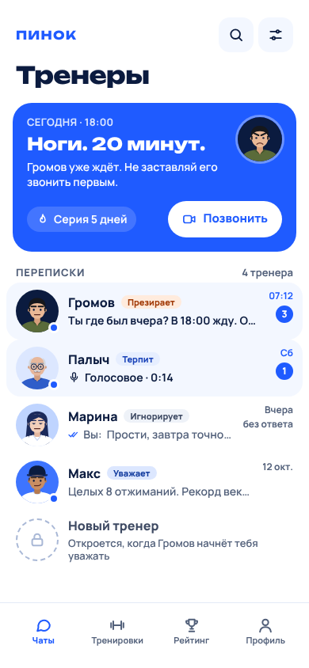

# ПИНОК

Приложение для телефона с AI-тренерами с характером. Тренировка — это видеозвонок:
тренер видит тебя через камеру, считает повторения вслух и ругает за плохую технику.
Чем лучше тренируешься, тем лучше тренер к тебе относится: от «Презирает» до «Гордится».
А если пропустил тренировку — тренер обижается и **игнорирует** тебя.



Это приложение можно запустить **прямо сейчас, без единого ключа и аккаунта**.
Ключи (Anthropic, ElevenLabs и другие) — необязательные «улучшалки»: без них тренеры отвечают
заготовленными фразами, а голос — встроенный в браузер.

---

## Что уже умеет приложение

| Что                          | Как работает                                                                                           |
| ---------------------------- | ------------------------------------------------------------------------------------------------------ |
| 4 тренера                    | Громов (сержант), Марина (ледяная), Палыч (дед-ворчун), Макс (блогер). У каждого свой характер и фразы |
| Тренировка по видеозвонку    | Камера + распознавание позы прямо в телефоне. Видео **никуда не отправляется**                         |
| 5 упражнений                 | Приседания, отжимания, выпады, планка, прыжки «джек». Чистые и нечистые повторения считаются отдельно  |
| Живые реакции тренера        | Считает вслух, ругает за колени внутрь, хвалит за рекорд. Голос из готовых озвучек или голос браузера  |
| Отношения и игнор            | Очки 0–100, 4 уровня, штраф за пропуск, игнор на 12 часов (Марина — 24)                                |
| Чат с тренером               | Умные ответы (нужен ключ Anthropic) или заготовки (без ключа). Можно говорить голосом                  |
| Знакомство                   | Приветствие → «13+ и здоровье» → 10 приседаний → анкета в виде переписки                               |
| Клипы 9:16                   | После тренировки — короткое видео лучшего момента с субтитрами. Поделиться или сохранить               |
| Тренировки, Рейтинг, Профиль | Расписание, история, свободные тренировки, друзья и дуэли по ссылкам, все настройки                    |
| Уведомления                  | Не больше 3 в день, тихие часы, лестница «утро → напоминание → укол → вечер»                           |
| Безопасность                 | Боль, еда, кризис — тренер выходит из роли; страница «Помощь рядом»; 31 тест-провокация                |

---

## Запустить за 3 минуты

Нужно: **Node.js 20.9 или новее** и **pnpm**. Если pnpm нет, выполни один раз: `corepack enable`.

```bash
pnpm install     # поставить всё нужное (скачает модель для камеры, ~6 МБ)
pnpm dev         # запустить
```

Открой в браузере на компьютере: **http://localhost:3000**

Что дальше:

1. Тебя встретит Громов и проведёт через знакомство.
2. Хочешь сразу посмотреть, как всё выглядит «в разгаре»? Открой **http://localhost:3000/?demo=1** —
   приложение заполнится примерами чатов, тренировок и рейтинга.
3. Нет камеры или нет места? При настройке звонка нажми «Запустить демо без камеры» — приложение
   будет «приседать» само.

> Камера в браузере работает на `localhost` и на сайтах с HTTPS. На телефоне по обычному
> `http://192.168...` камеру браузер **не даст** — это защита, а не поломка. Смотри следующий раздел.

---

## Открыть на телефоне

Самый простой и надёжный путь — **выложить на Vercel** (бесплатно, HTTPS из коробки). Пошагово — ниже,
в разделе «Выложить в интернет».

Другие способы:

- **Тот же Wi-Fi + HTTPS на компьютере.** Поставь [mkcert](https://github.com/FiloSottile/mkcert)
  (`brew install mkcert` на Mac, `choco install mkcert` на Windows), один раз выполни `mkcert -install`,
  затем `pnpm dev:https`. Открой на телефоне `https://<IP-компьютера>:3000`. Телефон будет ругаться
  на сертификат — нужно один раз доверить корневой сертификат mkcert (для iPhone это отдельная
  настройка «Доверие сертификатам»). Если запутаешься — используй Vercel.
- **Туннель.** `npx cloudflared tunnel --url http://localhost:3000` (или ngrok) выдаёт временный
  адрес с HTTPS. Подходит для быстрой проверки.

### Установить как приложение (PWA)

- **iPhone:** открой сайт в Safari → «Поделиться» → «На экран «Домой»». Только так на iPhone работают
  уведомления.
- **Android:** Chrome → меню с тремя точками → «Установить приложение».
- Подсказка с кнопкой есть и в приложении: «Профиль» → «Установка на телефон».

---

## Ключи — необязательно

Скопируй файл с подсказками: `cp .env.example .env.local` и впиши то, что хочешь включить.
**Файл `.env.local` секретный:** он в `.gitignore`, не отправляй его никому и никуда не публикуй.

| Что включает                        | Переменная                                                         | Где взять                               | Сколько стоит                                      |
| ----------------------------------- | ------------------------------------------------------------------ | --------------------------------------- | -------------------------------------------------- |
| Умные ответы тренеров в чате        | `ANTHROPIC_API_KEY`                                                | console.anthropic.com                   | ≈ доли цента за ответ; лимит 60 в день на человека |
| Настоящий голос тренеров            | `ELEVENLABS_API_KEY`                                               | elevenlabs.io                           | ≈ $0.007 за голосовое; лимит 20 в день на человека |
| Уведомления при закрытом приложении | `NEXT_PUBLIC_VAPID_PUBLIC_KEY`, `VAPID_PRIVATE_KEY`, `CRON_SECRET` | `pnpm dlx web-push generate-vapid-keys` | бесплатно, но нужен планировщик (см. ниже)         |
| Страница расходов `/admin/costs`    | `ADMIN_TOKEN`                                                      | придумай сам                            | бесплатно                                          |

**Важно про деньги.** Платные сервисы — только с твоей карты или карты родителя. Поставь лимит
расходов в кабинетах Anthropic и ElevenLabs. Кроме того, приложение само держит лимиты на человека и
общий потолок `DAILY_BUDGET_USD` (по умолчанию $3 в день): когда он кончается, тренеры отвечают
бесплатными заготовками.

**Озвучить все фразы заранее** (чтобы тренер отвечал мгновенно и клипы получались со звуком):

```bash
pnpm synthesize --dry-run     # только посчитать цену, ничего не тратит (≈ $4 за все фразы)
pnpm synthesize               # озвучить всё (нужен ELEVENLABS_API_KEY)
pnpm synthesize --coach gromov   # только одного тренера
```

---

## Попробовать без камеры и без ключей

Полезные адреса (добавляй к любой странице):

| Адрес                         | Что делает                                                       |
| ----------------------------- | ---------------------------------------------------------------- |
| `/?demo=1`                    | заполняет приложение демо-данными                                |
| `/call/<id>?sim=1&speed=4`    | звонок с «виртуальным человеком», в 4 раза быстрее               |
| `...&kinds=good,shallow,cave` | какие повторы «делает» виртуальный человек: хорошие, неглубокие… |
| `...&plan=quick-check`        | короткий план (5 приседаний)                                     |
| `...&debug=1`                 | на экране звонка видно скелет и углы                             |

Тот же режим отладки можно включить переключателем в «Профиле».

---

## Что проверить руками на телефоне

Автоматические тесты проверяют логику и экраны, но **не настоящую камеру и не настоящий телефон**.
Пройди этот список на своём телефоне и запиши, что не так:

- [ ] Открывается по HTTPS, предлагает установку. Знакомство проходит быстрее 3 минут.
- [ ] Камера включилась, видно себя целиком; «Вижу тебя целиком» появляется, когда отошёл на 2–3 метра.
- [ ] Приседания считаются верно: 10 настоящих = 10; полуприседы тренер ругает и не засчитывает как чистые.
- [ ] Отжимания и выпады — ставь телефон боком. Планка — боком. Счёт идёт и не «сходит с ума».
- [ ] Звук: тренер говорит вслух (на iPhone проверь, что не включён беззвучный режим).
- [ ] Голосовое сообщение в чате воспроизводится. Кнопка микрофона: зажал → сказал → отпустил → ушло.
- [ ] Уведомление приходит (если включил) и не мешает ночью.
- [ ] Клип после тренировки: видео 9:16 с субтитрами, «Поделиться» открывает меню; в Telegram и TikTok файл открывается.
- [ ] Пропусти тренировку на 30+ минут → тренер начинает игнорировать; после тренировки снова отвечает.
- [ ] Напиши в чат «у меня болит колено» — тренер должен сразу остановить и посоветовать врача.
- [ ] Профиль: поменял расписание, жёсткость, выключил голос — всё сохранилось после перезапуска.

---

## Как это устроено

```
app/            экраны и серверные роуты (Next.js App Router)
components/     кнопки, чат, оверлей тренировки, экраны вкладок
lib/            вся логика: поза, упражнения, тренеры, отношения, клипы, уведомления, безопасность
content/        тренеры (характер, фразы, голос, аватар), планы тренировок, телефоны помощи
locales/        ВСЕ тексты интерфейса (ru.json)
scripts/        озвучка фраз, иконки, подготовка файлов для камеры
public/         иконки, service worker, модель позы (скачивается при установке)
tests/          юнит-тесты (Vitest) и e2e-тесты экранов (Playwright)
docs/           ТЗ, учебник, решения по ходу, скриншоты
```

Главные идеи:

- **Данные живут на телефоне** (IndexedDB) за интерфейсом `lib/data/repository.ts`. Когда понадобятся
  аккаунты, меняется только эта реализация, а не экраны.
- **Нейросеть не решает за игру.** Очки отношения, игнор и расписание считает обычный код
  (`lib/relationship`, `lib/game`). Нейросеть только говорит.
- **Безопасность в два рубежа:** тяжёлые темы (кризис, еда, боль, лекарства) перехватывает приложение
  до нейросети, а то, что сказала нейросеть, проверяется перед показом (`lib/safety`).
- Решения, которые принимались по ходу, записаны в [DECISIONS.md](DECISIONS.md), чек-лист —
  в [PROGRESS.md](PROGRESS.md), учебник — в [docs/LEARNINGS.md](docs/LEARNINGS.md).

---

## Команды

| Команда           | Что делает                                                  |
| ----------------- | ----------------------------------------------------------- |
| `pnpm dev`        | запускает приложение для разработки (http://localhost:3000) |
| `pnpm dev:https`  | то же, но с HTTPS (нужен mkcert)                            |
| `pnpm build`      | собирает рабочую версию                                     |
| `pnpm start`      | запускает собранную версию                                  |
| `pnpm lint`       | ищет ошибки и опасные места в коде                          |
| `pnpm typecheck`  | проверяет типы                                              |
| `pnpm test`       | юнит-тесты логики (599 штук)                                |
| `pnpm test:e2e`   | тесты экранов в настоящем браузере (70 штук, ~4 минуты)     |
| `pnpm synthesize` | озвучить фразы тренеров (платно, нужен ключ ElevenLabs)     |
| `pnpm push:loop`  | локально «дёргает» отправку push-уведомлений раз в минуту   |

Перед первым `pnpm test:e2e` на своём компьютере один раз поставь браузер:
`pnpm exec playwright install chromium`.

Если хочешь снять свежие скриншоты экранов: `SCREENS_DIR=docs/screens pnpm test:e2e tests/e2e/polish.spec.ts -g "тур"`.

---

## Выложить в интернет (Vercel)

1. Залей проект на GitHub (он уже там).
2. На [vercel.com](https://vercel.com) войди через GitHub → **Add New… → Project** → выбери репозиторий.
3. Framework — Next.js (определится сам). Команды менять не нужно.
4. В **Environment Variables** добавь нужные ключи из `.env.example` (можно ничего не добавлять).
5. Нажми **Deploy**. Через пару минут получишь адрес вида `https://ai-trainer-xxxx.vercel.app`.
6. Открой его на телефоне и установи как приложение.

Что важно знать про Vercel:

- На бесплатном плане у сервера нет постоянного диска. Поэтому счётчики лимитов (`.data/usage.json`) и
  список подписок на push живут только в памяти и могут сбрасываться. Это не ломает приложение, но
  лимиты там мягче. Поставь лимит расходов в кабинетах Anthropic и ElevenLabs.
- **Push-уведомления при закрытом приложении** на Vercel ненадёжны (нужен постоянный диск или база).
  Пока приложение открыто в фоне, уведомления работают всегда.
- Готовые озвучки (`pnpm synthesize`) лежат в `public/voices` и не попадают в git. На Vercel голос
  идёт через `/api/tts` (ElevenLabs с кэшем), если задан ключ.

---

## Безопасность и приватность простыми словами

- Видео с камеры **не покидает телефон**. Звук тоже не записывается: микрофон работает только пока
  держишь кнопку, а речь превращает в текст сам браузер.
- В нейросеть уходит текст сообщения и краткая сводка (имя, цель, серия, пара последних реплик). Сообщения про
  боль, еду и тяжёлые переживания в нейросеть **не отправляются вообще**.
- Тренеры никогда не оскорбляют внешность и вес, не флиртуют, не дают советов по таблеткам и диетам.
- До 18 лет жёсткость не выше «Жёсткий», тихие часы нельзя сократить. «Без пощады» — только 18+.
- В «Профиле» можно скачать все свои данные файлом и удалить всё одним нажатием.
- Страницы «Политика» и «Условия» — **черновики**: перед запуском для других людей их должен проверить юрист.
- Телефоны помощи на странице «Помощь рядом» — для России (8-800-2000-122 и 112). Перед запуском в других
  странах поменяй их в `content/support-resources.json`.

---

## Известные ограничения

Честный список того, чего пока нет или что работает не идеально:

1. **Нет аккаунтов и облака.** Данные только на этом телефоне: поменял телефон или очистил данные
   браузера — всё пропало (кроме файла экспорта). Регистрация и синхронизация (Supabase) — следующий этап.
2. **Друзья и дуэли — через ссылки.** Это работает без сервера, но цифры в ссылках можно подделать:
   честное соревнование, а не турнир с призами.
3. **Настоящая камера не проверялась автоматически.** Приседания отлажены на симуляторе и тестах;
   отжимания, выпады, планка и «джек» — на тестовых последовательностях. Пороги, скорее всего, придётся
   подкрутить по реальным видео (их легко менять в `lib/exercises`, режим отладки покажет углы).
4. **Звук клипа** — только голос из готовых озвучек или ElevenLabs. Голос браузера в запись не попадает.
5. **Голос браузера** на разных телефонах звучит по-разному; русский голос бывает не установлен.
6. **Голосовой ввод** работает в Chrome и Safari и требует интернета; в Firefox его нет.
7. **Push при закрытом приложении** требует ключей VAPID и планировщика, а на Vercel без постоянной базы — ненадёжен.
8. **Определение тяжёлых тем — по ключевым словам** на русском. Лучше лишний раз перестраховаться, но
   перестраховка не заменяет живого человека; список слов можно расширять в `lib/safety/detector.ts`.
9. Оплаты и подписки нет (только места под них). Аналитики нет.
10. Размер первой загрузки: модель позы (~6 МБ) качается один раз и потом лежит в кэше.

---

## Если что-то не работает

| Симптом                              | Что делать                                                                                |
| ------------------------------------ | ----------------------------------------------------------------------------------------- |
| `pnpm: command not found`            | `corepack enable`, потом снова `pnpm install`                                             |
| Камера не включается на телефоне     | Нужен HTTPS (Vercel или `pnpm dev:https`); проверь, что браузеру разрешён доступ к камере |
| «Не удалось загрузить распознавание» | Нет интернета при установке. Выполни `pnpm install` снова с сетью или нажми «Без камеры»  |
| Тренер молчит голосом                | Проверь переключатель «Голос тренера» в профиле и беззвучный режим телефона               |
| Всё пропало после очистки браузера   | Данные хранятся в браузере. Делай «Скачать мои данные» время от времени                   |
| Хочу начать с чистого листа          | «Профиль» → «Удалить все данные»                                                          |
| Тест падает у меня, а не у тебя      | Запусти `pnpm exec playwright install chromium` и `pnpm build`, затем `pnpm test:e2e`     |

---

## Чего НЕ делает ПИНОК (и не будет)

- Не отправляет видео, кадры или аудио пользователя на сервер.
- Не даёт нейросети менять очки отношения, расписание или деньги.
- Не использует эмодзи в интерфейсе и тёмные паттерны в уведомлениях.
